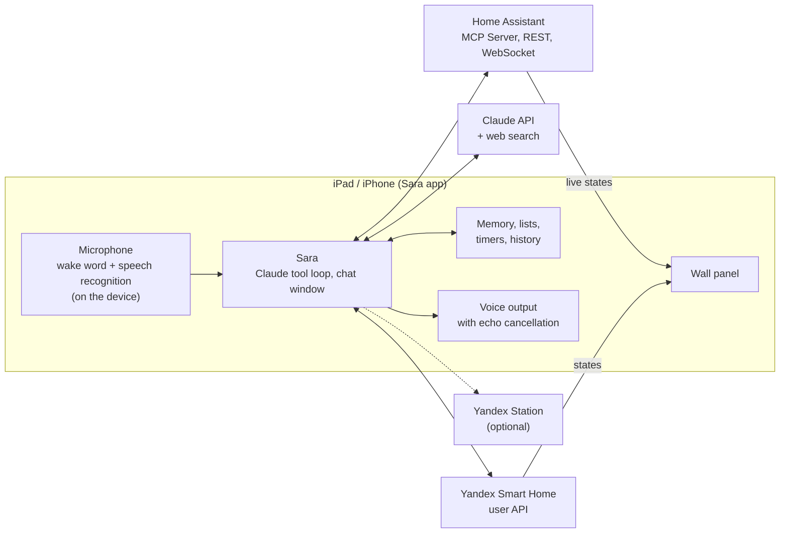

# Sara

**A voice assistant for your smart home, built on Claude.** Hang an iPad on the wall, say *"Sara, make the living room warmer and dimmer"*, and she does it.

Sara is an iPad and iPhone app. The brain lives in the app: it talks to the Claude API directly and controls your home through Home Assistant, Yandex Smart Home (Alice), or both. No server, no add-on, no cloud of its own.

[](LICENSE)


```
You:   Sara, is the printer still going?
Sara:  Yes, 78 percent, about 40 minutes left. It finishes at 12:06.
You:   And the washer?                          (no wake word needed right after an answer)
Sara:  Rinsing, 15 minutes left.
You:   Make the living room cozy for a movie and put on some jazz on YouTube.
Sara:  Done: warm light at 30 percent, jazz is playing on the TV.
You:   Thanks, that's all.
Sara:  Enjoy the movie!                         (the conversation closes by itself)
```

## Features

**Talking to Sara**
- Wake word ("Sara", configurable), recognized on the device.
- Follow-ups without the wake word for a while after each answer, like Alice's continuous dialog.
- Knows when speech is not for her: people talking to each other, the TV, the radio. Such speech is dropped and forgotten.
- Ends the conversation herself on "thanks, bye" or "ok".
- Interrupt her any time: "stop", "enough", or just start talking. Echo cancellation keeps her from hearing herself.
- Add to a question while she is still thinking ("...and in the bedroom too").
- Answers stream: she starts speaking while the rest of the answer is still being written.

**Doing things**
- Controls the home through **Home Assistant** (lights, switches, climate, media players, scripts, to-do lists) and **Yandex Smart Home** (devices and scenarios of Alice, beta).
- Knows the state of the whole home with every question, so "is the window open?" takes one round trip.
- Knows which room each panel is in: "Sara, lights" means the lights here.
- **Timers and alarms** that ring even when the app is in the background, shown on the panel with a live countdown.
- **Lists** (to-do, shopping, packing), created and edited by voice and shown on the panel. Home Assistant lists stay shared with other assistants.
- **Web search** for news, weather and facts.
- Plays videos and music on an Apple TV through a Home Assistant script (see [Tips](#tips)).

**Remembering**
- Sara remembers preferences, routines and corrections on her own ("I like warm light in the evening"), without being asked.
- After each conversation she reviews it for anything worth keeping.
- Everything she remembers is listed in Settings, and you can delete any of it.
- The chat history stays on the device.

**The wall panel**
- Clock, date and weather, rooms with tiles, sliders, thermostats.
- Running devices (3D printer, washer, dryer) with progress, time left and finish time, and a "done" card when they finish.
- Timers, alarms and lists.
- Night mode: a dim clock, and Sara answers in text only.
- The layout is built from your Home Assistant areas (or Yandex rooms) on first launch, and fully editable in Settings.
- Live updates over the Home Assistant WebSocket API.

**Voice output** on the iPad, or on a Home Assistant speaker that reads text aloud, such as a Yandex Station.

English and Russian. More languages can be added in the string catalogs.

## How it works



1. The microphone listens all the time, but speech is recognized **on the device**. Nothing leaves it until it hears the wake word.
2. The phrase goes to Claude together with the current state of the home, the time, the room of this panel, what Sara remembers and your lists.
3. Claude answers, calling tools as needed: Home Assistant's MCP tools, the Yandex Smart Home API, Sara's own tools (memory, lists, timers, ending the conversation), web search.
4. The answer is spoken sentence by sentence as it arrives, and shown on screen.

## Quick start

You need an iPad or iPhone with iOS 18+, a Mac with Xcode, a [Claude API key](https://console.anthropic.com) with some credit, and Home Assistant reachable from the iPad (local network or VPN) or a Yandex Smart Home.

1. **Home Assistant:** add the *Model Context Protocol Server* integration, expose your devices to Assist, and create a token for a non-admin user. [Details](#home-assistant).
2. **Clone and open** `Sara.xcodeproj`, set your Apple developer team (see [Build](#build)), and run on your device.
3. **In Settings** enter the Claude API key, the Home Assistant address and the token. Tap *Check connection*.
4. Pick the room of this panel in Settings > Sara.
5. Say *"Sara, turn on the light"*.

## Setup

### Home Assistant

1. **MCP Server.** Settings > Devices & services > Add integration > *Model Context Protocol Server*. Choose the *Assist* API.
2. **Expose devices.** Settings > Voice assistants > Expose. Sara sees and controls exactly what Assist sees. Scripts work too: give them a clear name and description, and Sara will use them.
3. **A user for Sara.** Settings > People > Add person, allow login, **not** an administrator. Log in as that user, open the profile > Security > Long-lived access tokens, and create a token.
   A non-admin token can control exposed devices but cannot change your configuration.
4. **Address.** Use the local address, e.g. `http://192.168.1.10:8123`, or a VPN address (Tailscale works). iOS asks for local network access on first use, allow it.

### Yandex Smart Home (beta)

For a home with Alice and no Home Assistant, or both:

1. Register an app at [oauth.yandex.ru](https://oauth.yandex.ru/client/new/): platform *Web services*, redirect URI `https://oauth.yandex.ru/verification_code`, rights *iot:view* and *iot:control*.
2. Put its ClientID in `Config/Local.xcconfig`: `YANDEX_CLIENT_ID = ...`
3. In Settings > Yandex Smart Home tap *Get a token*, sign in, copy the token Yandex shows and paste it.

Sara gets the whole Yandex home (rooms, devices, state, scenarios) with every question and controls it through the [Yandex Smart Home user API](https://yandex.ru/dev/dialogs/smart-home/doc/ru/concepts/platform-protocol). If the same devices are in both Home Assistant and Yandex, connect only one of them, or Sara sees every device twice.

### Yandex Station as Sara's voice (optional)

Sara can answer through a Yandex Station (Alice's voice) instead of the iPad. Install the [Yandex Station integration](https://github.com/AlexxIT/YandexStation) in Home Assistant and use the station in **local mode**: cloud mode cuts text to 100 characters. Then pick the station in Settings > Voice > Speaker.

The station can be interrupted too: Sara stops it when you start talking.

### Build

1. Create `Config/Local.xcconfig` (git-ignored) with your Apple developer team:
   ```
   DEVELOPMENT_TEAM = ABCDE12345
   ```
   Or pick the team in Xcode under Signing & Capabilities. Change the bundle identifier if Xcode asks.
2. Run the `Sara` scheme on your device. A free Apple ID works for your own devices.

## Things to say

| | |
|---|---|
| Home | "Sara, turn off the lights in the kitchen", "make it warmer and dimmer", "set the TV volume to 30", "is the window in the bathroom open?" |
| Devices | "how long until the washer is done?", "is the printer still going?" |
| Timers | "a timer for 10 minutes for the pasta", "wake me up at 7:30", "what timers are set?", "cancel the timer" |
| Lists | "make a weekend to-do list: wash the car, buy paint", "what's on the list?", "cross off the paint", "add milk to the shopping list" |
| Memory | "I like warm light in the evening", "the ceiling light in the hall is called 'the big light'", "forget that" |
| Anything | "what's the news?", "what's the weather tomorrow?", "how do I descale a kettle?" |
| Conversation | "stop", "thanks, that's all", "ok" |

## Settings

| Page | What is there |
|---|---|
| Sara | Claude API key and model, the room of this panel, house notes, how long a conversation lasts |
| Home Assistant | Address, token, connection check |
| Yandex Smart Home | Token, connection check |
| Voice | Wake word, how long Sara listens after an answer, voice output (device or a speaker) |
| Panel | Blocks, rooms, devices, weather. Build from Home Assistant or Yandex |
| Night mode | On or off, start and end hours |
| Memory | Everything Sara remembers, swipe to delete |

**House notes** are the easiest way to tune Sara for your home: what things are called, what not to touch, how a script should be used. They are added to her instructions.

## Cost

Sara uses your Claude API key, so you pay Anthropic directly, per use.

- The default model is `claude-opus-5-5` ($4 / $20 per million input / output tokens) with low effort, for the best understanding of messy spoken requests.
- `claude-haiku-5-5` ($0.10 / $0.50) is much cheaper and faster. Set it in Settings > Sara > Model.
- Web search costs $10 per 1,000 searches plus the tokens of what it reads.
- The home state is sent with every phrase, so a big home means more input tokens per request. Prompt caching keeps the repeated part cheap.

See [Anthropic pricing](https://www.anthropic.com/pricing) for current prices.

## Privacy

- Speech is recognized **on the device**. Nothing leaves it until the wake word, or within the short window after Sara's answer.
- What you say to Sara goes to the Claude API, and for home control to your Home Assistant or Yandex. Speech Sara decides was not for her is dropped from the conversation, the history and the memory.
- History, memory and lists are stored on the device. Keys and tokens are in the Keychain.
- Sara's Home Assistant user is not an administrator.

## Tips

**A wall-mounted iPad**
- The app keeps the screen on by itself. Use Guided Access (Settings > Accessibility) to lock the iPad to Sara.
- An iPad that is always plugged in ages its battery. Newer iPads have an 80% charge limit in Settings > Battery. For older ones, put the charger on a smart plug and let Home Assistant keep the battery between about 40% and 80% with the battery sensor of the Home Assistant Companion app.

**Music and videos on an Apple TV.** A Home Assistant script with an optional `url` field can open a YouTube link on the Apple TV (`media_player.play_media` with `media_content_type: url` and a `youtube://` link). Describe it well, expose it to Assist, and Sara will find a video with web search and play it: *"Sara, put on some Metallica"*.

**A personal panel layout** can ship with your build in `Sara/Resources/Panel.local.json` (git-ignored), in the same format the app stores.

## Troubleshooting

| Problem | What to check |
|---|---|
| "Could not connect" to Home Assistant | The address has `http://` and the port. iOS local network access is allowed for Sara (Settings > Privacy > Local Network). |
| Sara does not react to the wake word | Microphone and speech recognition are allowed for Sara. The wake word is on in Settings > Voice. |
| Sara mishears device names | Add the names to House notes, e.g. "'printing' means the 3D printer in the study". |
| A device is missing | It is not exposed to Assist in Home Assistant. |
| The Yandex Station cuts the answer | The station is in cloud mode. Switch the integration to local mode. |
| A timer does not ring | Notifications are allowed for Sara, and Focus or Do Not Disturb is not silencing them. |

## Development

```
Sara/
├── App/          the app and the root screen
├── Assistant/    Sara (Claude tool loop, chat window, memory review), memory, lists, timers
├── Home/         Home Assistant (MCP, REST, WebSocket), Yandex Smart Home, live home state
├── Speech/       wake word, speech recognition, voice output, echo cancellation
├── Services/     Claude API, Keychain
├── Models/       stored data and the panel layout
├── Views/        Panel, Talk (conversation, history, lists), Settings
└── Resources/    Prompts, Tools (tool definitions for Claude), string catalogs
Checks/           self-checks that run with swiftc
```

- **Prompts** are plain files in `Resources/Prompts`, **tool definitions** are JSON in `Resources/Tools`. Tune Sara there, not in Swift.
- **Every user-visible string** goes to `Resources/Localizable.xcstrings` with its translations.
- **One type per file.**
- Run the checks: see the command at the top of `Checks/PanelBuildCheck.swift`.

## Roadmap

- iCloud sync of history, memory and lists between panels.
- Music on the Yandex Station, pausing it while Sara listens.
- A custom wake word model ([LiveKit Wakeword](https://github.com/livekit/livekit-wakeword)) if Apple's speech recognition is not good enough for it.

## License

[Apache 2.0](LICENSE).

Sara is not affiliated with Anthropic, Home Assistant, Yandex or Apple.
